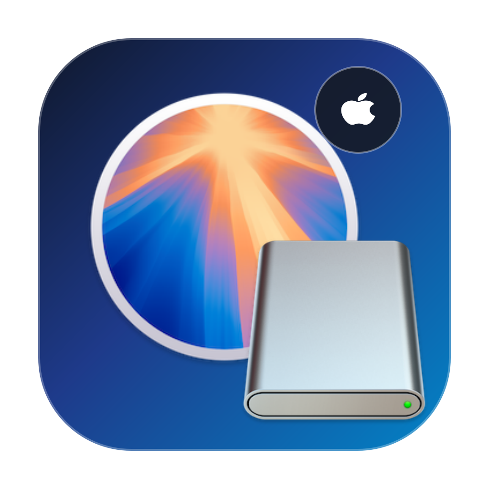

<p align="center"></p>

# macOS Studio

**macOS-Installer laden, lokale Installer verwalten und bootfähige USB-Sticks erstellen.** Eine native macOS-App mit SwiftUI, Gerätebildern und einer übersichtlichen Mac-Modellauswahl.

**[DMG herunterladen](https://github.com/kislab/macos-studio/releases/latest)** · **[Fehler melden](https://github.com/kislab/macos-studio/issues)**

## Installation

1. Die **macOS-Studio-1.2.14-Universal.dmg** unter [Releases](https://github.com/kislab/macos-studio/releases) herunterladen.
2. Die DMG öffnen und **macOS Studio** auf **Programme** ziehen.
3. Die DMG auswerfen und die App aus Programme starten.

**Systemanforderungen:** macOS 13 Ventura oder neuer. Die DMG enthält Intel (`x86_64`) und Apple Silicon (`arm64`) in einer Universal-App. Python wird nicht benötigt.

**Signierung:** Diese Version ist lokal ad-hoc signiert, jedoch nicht mit einer Developer ID signiert oder Apple-notarisiert. macOS kann beim Öffnen des Downloads eine Sicherheitswarnung anzeigen. Eine notarisiert veröffentlichte Version steht noch aus.

## Updates direkt in der App

Ab **Version 1.2** prüft die App automatisch auf neue Versionen. Seit **1.2.2** sucht sie direkt bei jedem Start und danach alle sechs Stunden. Du bekommst einen Hinweis und kannst das Update direkt installieren lassen – ohne eine DMG zu öffnen. Sparkle lädt das Update, prüft dessen Signatur und startet die aktualisierte App neu. Manuell prüfen: **macOS Studio → Nach Updates suchen …**.

**Nutzer von 1.1 müssen 1.2 einmal normal installieren**, da die alte Version noch keinen Updater enthält. Neue Updates erfordern ein veröffentlichtes, signiertes Release; ein GitHub-Commit allein genügt nicht. [Anleitung zum Veröffentlichen](docs/UPDATES.md).

## Funktionen

| Bereich | Funktionen |
| --- | --- |
| **Installer laden** | Live-Angebot von Apple, Versionssuche, Ziel-Mac-Filter, manuelle Versionsanforderung und passende Installer-Symbole. |
| **Installer lokal** | Vorhandene Installer mit Größe und Pfad anzeigen, im Finder öffnen, für USB auswählen oder nach Bestätigung in den Papierkorb verschieben. |
| **Mac prüfen** | Automatische Modellkennung, Gerätebilder, Modell- und Baujahrfilter, Kompatibilitätsübersicht und aufklappbare Details. |
| **USB erstellen** | Externe USB-Volumes erkennen und mit Apples `createinstallmedia` ein bootfähiges Installationsmedium erstellen. |

### Downloads

Die App verwendet Apples `softwareupdate`. Es werden nur die für den ausführenden Mac angebotenen Installer angezeigt. Ein Ziel-Mac-Filter erweitert dieses Angebot nicht. Manuell eingegebene Versionen sind nicht vorab auf Verfügbarkeit geprüft.

Der Balken übernimmt Apples Prozentangaben. Die GB-Anzeige ist mit `≈` als Schätzung aus Paketgröße und Fortschritt gekennzeichnet: Die Vorbereitungsphase kann auch Entpacken enthalten. Die App zeigt keine Mbit/s an. Speicherprüfung, Zeitlimits, Downloadabbruch und Protokoll sind enthalten.

### Lokale Installer

Gesucht wird in `/Applications` sowie Programme, Downloads und Schreibtisch im Benutzerordner. Andere Speicherorte lassen sich manuell hinzufügen. Unvollständige Installer bleiben mit Warnhinweis sichtbar und können entfernt werden. Für USB werden zusätzlich lesbare, nicht leere Installationsdaten in `Contents/SharedSupport` vorausgesetzt; das ist keine vollständige Integritätsprüfung. Erkannt werden Installer-Apps mit ausführbarem `createinstallmedia`; die Suche ist keine vollständige Laufwerksdurchsuchung und erfasst keine beliebigen DMG-/PKG-Dateien.

**Löschen verschiebt die ausgewählte Installer-App in den Papierkorb.** Das installierte Betriebssystem bleibt erhalten. Der Installer wird vor dem Verschieben erneut geprüft; während laufender Vorgänge ist Löschen gesperrt. Speicher wird erst beim Leeren des Papierkorbs freigegeben.

### USB-Installationsmedium

Die Erstellung **löscht das ausgewählte Ziel-Volume**. Vorher werden Zielbestätigung und macOS-Administratorfreigabe angefordert. Interne Laufwerke werden ausgeschlossen; Volume-UUID, Mountpoint und intern/extern werden vor dem Schreiben erneut geprüft.

Während des administrativen Schreibvorgangs gibt es einen laufenden Status, keine Live-Prozentanzeige. Das Protokoll erscheint nach Abschluss. Ein Abbruch des USB-Schreibens ist nicht vorgesehen.

## Bekannte Grenzen und Teststand

- Die Kompatibilitätsdatenbank ist lokal gespeichert und keine aktuelle Live-Auskunft von Apple.
- Nicht jedes historische Modell und nicht jeder zukünftige macOS-Release ist enthalten.
- Ein Test auf echter Intel-Hardware steht aus; beide Architekturen sind im Build enthalten.
- Oberfläche, Apple-Katalogabfrage, USB-Erkennung und neun automatisierte Prüfgruppen wurden geprüft.
- Ein vollständiger Installer-Download und ein echter USB-Schreibvorgang wurden für dieses Release nicht durchgetestet.

## Selbst bauen

Voraussetzung: Apple-Entwicklungswerkzeuge mit Swift und Unterstützung für beide Architekturen.

```sh
git clone https://github.com/kislab/macos-studio.git
cd macos-studio
./native/build-app.sh
```

Die Universal-App liegt anschließend im Projekt-Hauptordner. Zum Erstellen der DMG:

```sh
./native/build-dmg.sh
```

Eine bereits vorhandene DMG muss vorher umbenannt werden. Für die lokale Erstellung wird ad-hoc signiert; der Build führt keine Notarisierung durch.

### Prüfungen

```sh
swift run --package-path native StudioChecks
```

Neun Prüfgruppen decken Parser, Eingabevalidierung, Fortschrittsmetriken, USB-Laufwerksschutz, Escaping, Prozessausgabe, Zeitlimits, Abbruch sowie lokale Installer und Papierkorbverhalten ab. Kein XCTest erforderlich. Der Papierkorbtest verwendet ausschließlich eine selbst erstellte Test-App.

### Prüfsumme des Downloads

DMG und zugehörige `.sha256`-Datei in denselben Ordner laden und dort ausführen:

```sh
shasum -a 256 -c SHA256SUMS.txt
```

## Projektstruktur

- `native/Sources/MacOSStudio`: SwiftUI-Oberfläche, Ressourcen und Anwendungslogik
- `native/Sources/StudioCore`: Prozessrunner, Modelle, Parser und Installer-Verwaltung
- `native/Tests/StudioCoreTests`: ausführbare Swift-Prüfungen
- `native/build-app.sh`: Universal-Build und App-Bundle
- `native/build-dmg.sh`: DMG und Prüfsumme
- `assets/icons/AppIcon.icns`: App-Icon für den Build

Unabhängiges Projekt, nicht von Apple entwickelt oder unterstützt. macOS und zugehörige Produktnamen sind Marken von Apple.
